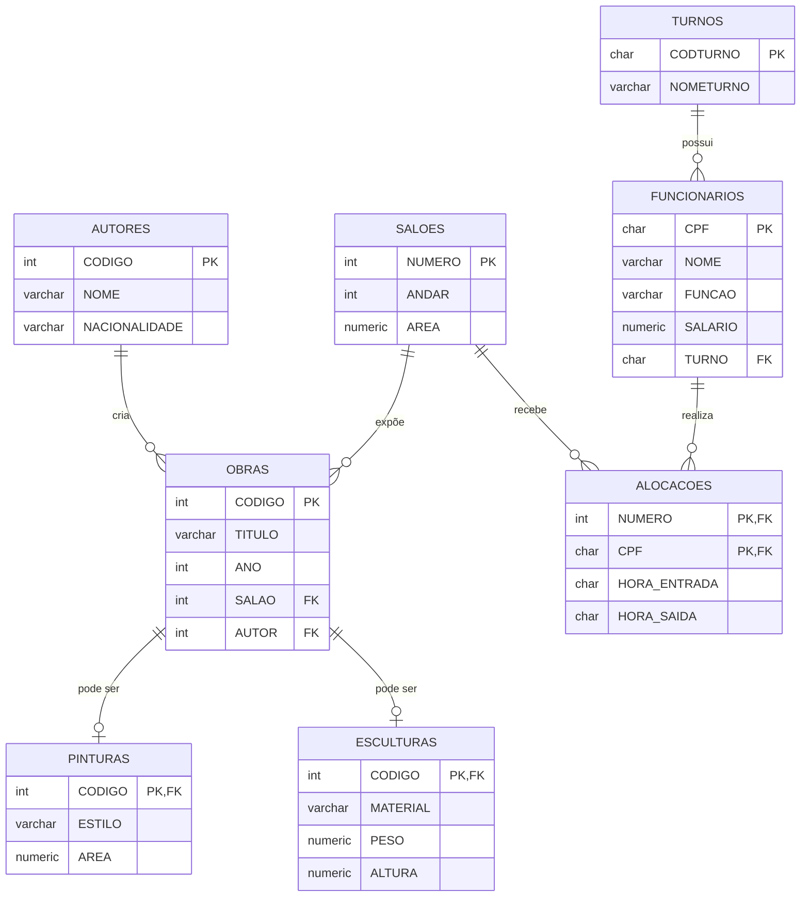

# 🏛️ Banco de Dados de Museu — Portfólio SQL

Projeto de modelagem e consultas em SQL sobre o acervo e a equipe de um museu. O objetivo é demonstrar domínio de **DDL, DML, JOINs, agregações, subconsultas, CTEs e funções de janela** em um modelo relacional com casos de borda reais.

## 📌 Sobre o projeto

O banco representa:

- **Acervo:** obras de arte, que podem ser pinturas ou esculturas, e seus autores.
- **Espaço físico:** salões distribuídos em andares, onde as obras ficam expostas.
- **Equipe:** funcionários (seguranças e faxineiros), seus turnos e as alocações por salão e horário.

## 🗂️ Estrutura do repositório

```
.
├── README.md      # este arquivo
├── schema.sql     # criação das tabelas, inserts e chaves estrangeiras
└── queries.sql    # 20 consultas organizadas por nível de dificuldade
```

## 🧩 Modelo de dados



### Decisões de modelagem

- **Especialização:** `PINTURAS` e `ESCULTURAS` compartilham a chave primária de `OBRAS` (relação 1:0..1), guardando apenas os atributos específicos de cada tipo.
- **Tabela associativa:** `ALOCACOES` liga funcionários a salões (N:N), com chave composta `(NUMERO, CPF)`.
- **Integridade referencial:** todas as chaves estrangeiras são criadas com `ALTER TABLE` ao final do script `schema.sql`.

## ▶️ Como executar

**SGBD utilizado:** PostgreSQL 

1. Crie um banco de dados vazio.
2. Execute o script de criação e carga:
   ```bash
   psql -d nome_do_banco -f schema.sql
   ```
3. Execute as consultas:
   ```bash
   psql -d nome_do_banco -f queries.sql
   ```

> Alguns comandos variam entre SGBDs (`LIMIT` no PostgreSQL/MySQL, `TOP` no SQL Server, `FETCH FIRST` no Oracle). Ajuste se necessário.

## 🔍 Consultas

As consultas estão em [`queries.sql`](queries.sql), cada uma comentada com o objetivo e, quando aplicável, o resultado esperado.

### Nível básico — `SELECT`, `WHERE`, `ORDER BY`

| # | Pergunta de negócio |
|---|---------------------|
| 1 | Quais obras foram criadas antes de 1950? |
| 2 | Quais funcionários ganham mais de R$ 1.000? |
| 3 | Quais salões do 3º andar têm mais de 50 m²? |

### Nível intermediário — `JOIN`, `GROUP BY`, `HAVING`

| # | Pergunta de negócio |
|---|---------------------|
| 4 | Quais obras existem, com autor e localização no museu? |
| 5 | Quais autores não têm nenhuma obra no acervo? |
| 6 | Quais salões estão vazios? |
| 7 | Quantas obras cada autor possui? |
| 8 | Quais autores têm mais de 2 obras? |
| 9 | Qual a média salarial e o número de funcionários por turno? |
| 10 | Qual é a escultura mais pesada do acervo? |
| 11 | Quais os estilos das pinturas de Salvador Dalí? |
| 12 | Quantas obras há em cada andar? |

### Nível avançado — subconsultas, `CASE`, `EXISTS`, CTE e funções de janela

| # | Pergunta de negócio |
|---|---------------------|
| 13 | Quais funcionários ganham acima da média geral? |
| 14 | Como classificar as obras por período histórico? |
| 15 | Qual o ranking salarial dentro de cada turno? |
| 16 | Qual a obra mais antiga de cada autor? |
| 17 | Quais funcionários atuam em mais de 2 salões diferentes? |
| 18 | Quais pinturas têm área acima da média? |
| 19 | Quais autores têm pintura **e** escultura no acervo? |
| 20 | Quantas horas cada funcionário tem alocadas? |

### Exemplo

```sql
-- Autores com mais de 2 obras (resultado esperado: Dalí e Picasso)
SELECT A.NOME, COUNT(*) AS QTD_OBRAS
FROM AUTORES A
JOIN OBRAS O ON O.AUTOR = A.CODIGO
GROUP BY A.NOME
HAVING COUNT(*) > 2;
```

## ⚠️ Casos de borda e qualidade de dados

O conjunto de dados inclui situações propositais que testam a robustez das consultas:

- **Autor sem obra** (`AUTOR SEM OBRA`) → exige `LEFT JOIN` para aparecer em contagens.
- **Salões sem obras** (11 e 28) → idem.
- **Salão sem área definida** (`NULL`) → atenção em cálculos e filtros numéricos.
- **Formato de hora inconsistente** em `ALOCACOES`: valores como `'13:00'` e `'1300'` convivem na mesma coluna. A consulta 20 normaliza os dois formatos com `REPLACE` e `SUBSTR`.

> 💡 Em um cenário real, o ideal seria padronizar essa coluna para o tipo `TIME` e adicionar uma restrição `CHECK (HORA_SAIDA > HORA_ENTRADA)`.

## 🛠️ Conceitos praticados

- Modelagem relacional e chaves primárias/estrangeiras
- `INNER JOIN` e `LEFT JOIN` (inclusive em 3 tabelas)
- Agregações: `COUNT`, `SUM`, `AVG`
- `GROUP BY` e `HAVING`


## 👤 Autor

**LUCAS DE PAULO GUIMARÃES**
🔗 [LinkedIn](https://www.linkedin.com/in/lucas-de-paulo-guimarães-a930b2413) · 📧 lucaspaulo555@outlook.com

---

⭐ Se este projeto foi útil, deixe uma estrela no repositório!
